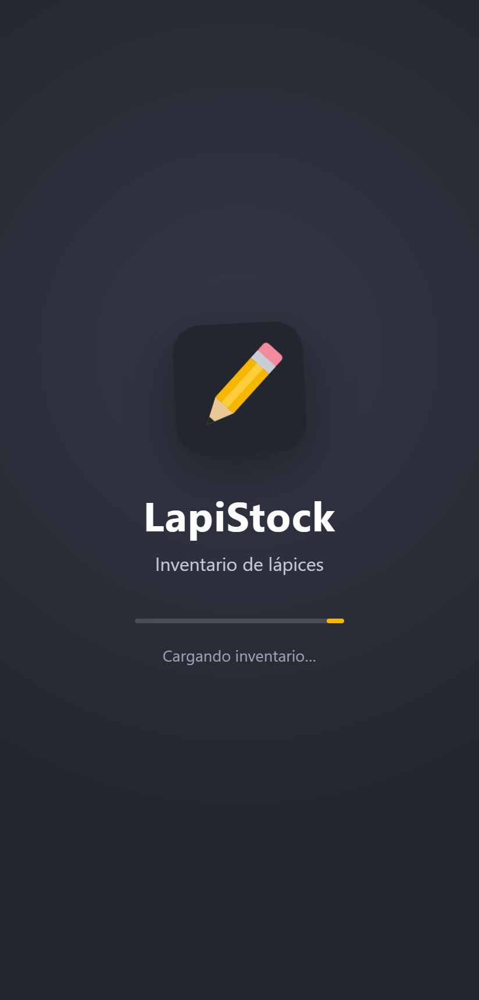
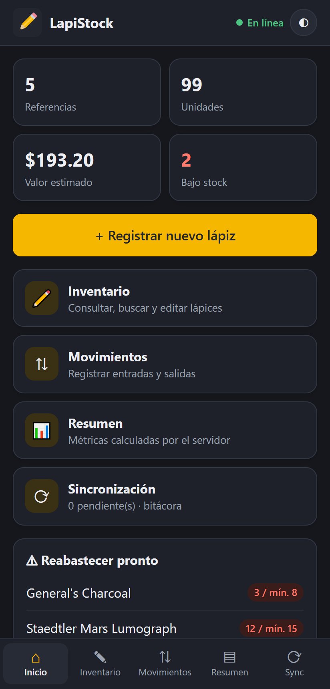

# LapiStock — Documento técnico

**Proyecto:** PWA de inventario de lápices con soporte offline y sincronización.
**Fecha:** 17/10/2026

> **Actualización 24/10/2026:** el ciclo de vida del Service Worker (con aviso de actualización),
> las notificaciones locales y push, y la cámara se documentan en
> [Service Worker, notificaciones y cámara](FUNCIONES-NATIVAS.md).

---

## 1. Parte 1 — Diseño

### 1.1 Proyecto seleccionado

Inventario de lápices para una papelería, escuela o taller de dibujo. El encargado necesita consultar
y actualizar existencias desde el móvil incluso en lugares con mala señal (bodega, aula), por eso
la app debe seguir funcionando sin conexión.

**Información que se muestra**

- Lista de lápices: marca, modelo, tipo (grafito, color, mecánico, carboncillo, acuarelable), dureza,
  color, precio unitario y stock actual.
- Indicador de **bajo stock** (stock ≤ stock mínimo) y lista «Reabastecer pronto».
- Historial de movimientos (entradas/salidas) con fecha y nota.
- Resumen del servidor: referencias, unidades, valor total del inventario, unidades por tipo y
  movimientos del día.
- Estado de conexión, operaciones pendientes y bitácora de sincronización.

**Datos que se pueden registrar**

| Registro | Campos |
|---|---|
| Lápiz | marca*, modelo*, tipo*, dureza, color, cantidad inicial, stock mínimo, precio |
| Movimiento | lápiz*, tipo (entrada/salida)*, cantidad*, nota |
| Edición / baja | datos descriptivos del lápiz / eliminación |

### 1.2 Pantallas

#### Splash Screen



- **Qué muestra:** logotipo (lápiz amarillo sobre fondo grafito), nombre «LapiStock», lema y una
  barra de carga animada.
- **Implementación técnica:** componente `Splash.tsx` superpuesto (`position: fixed`) mientras
  `useInventario` abre IndexedDB y lee los datos locales. Se mantiene un **mínimo de 1,6 s** para
  que la marca sea visible aunque la carga sea instantánea, y sale con un fundido de 0,4 s. Además el
  `manifest.webmanifest` define `background_color` e íconos, así que al instalarla Android genera un
  splash nativo con los mismos colores (transición sin saltos).
- **Justificación:** la carga de IndexedDB es asíncrona; el splash evita mostrar una Home vacía y
  después «saltar» con los datos, y refuerza la identidad de la app instalada. Respeta
  `prefers-reduced-motion`.

#### Home Screen



- **Qué muestra:** cabecera fija con logo, estado de conexión (En línea / Sin conexión), contador de
  pendientes y botón de tema; 4 KPIs calculados en el cliente; botón principal «Registrar nuevo
  lápiz»; 4 accesos rápidos a las funcionalidades; alerta de reabastecimiento.
- **Navegación:** barra inferior con 5 secciones (Inicio, Inventario, Movimientos, Resumen, Sync)
  al estilo app móvil; en pantallas ≥ 900 px pasa a pestañas superiores. La última sección visitada
  se recuerda en `localStorage`.
- **Justificación:** la acción más frecuente (registrar) está a un toque; la navegación inferior queda
  al alcance del pulgar; el estado de conexión siempre visible deja claro cuándo los cambios quedan
  en cola. Tema claro/oscuro con tokens CSS.

Otras vistas: [Inventario](capturas/03-inventario.png) · [Movimiento offline](capturas/06-offline-movimiento.png) ·
[Cola offline](capturas/07-offline-cola.png) · [Resumen del servidor](capturas/10-resumen-servidor.png).

### 1.3 Qué se genera en el cliente y qué en el servidor

| Cliente (navegador) | Servidor (Express + SQLite) |
|---|---|
| UUID de cada lápiz/movimiento (`crypto.randomUUID`) → base de la idempotencia | Persistencia definitiva en SQLite |
| Fecha de creación (`creado_en`), aunque sea offline | Fecha de recepción/actualización (`recibido_en`, `actualizado_en`) |
| Validación previa de formularios (UX inmediata) | **Validación autoritativa** (tipos, rangos, UUID, longitudes) → 400 |
| Búsqueda, filtros por tipo y «solo bajo stock» | Cálculo real del stock en **transacción** (`BEGIN IMMEDIATE`) |
| KPIs locales (referencias, unidades, valor estimado, bajo stock) — funcionan offline | Rechazo de salidas sin stock suficiente → **409** |
| Actualización optimista del stock local | Detección de duplicados por `id` → `duplicado: true` |
| Cola de operaciones pendientes (IndexedDB) y reintentos | Resumen agregado con SQL (`SUM`, `GROUP BY`, valor total, movimientos de hoy) |
| Preferencias y bitácora (localStorage) | Datos de ejemplo iniciales (seed) |

---

## 2. Parte 2 — Implementación

### 2.1 Herramientas

| Herramienta | Versión | Uso |
|---|---|---|
| Node.js | 24.21 (mín. 22.13) | Runtime del servidor, `node:sqlite`, `node:test` |
| Express | 5.x | API REST y servidor estático del build |
| SQLite | 3.53 (incluido en Node) | Base de datos en un archivo, sin instalar servidor |
| React | 19.2 | Interfaz |
| TypeScript | 6.0 | Tipado del front |
| Vite | 8.3 | Dev server con proxy `/api`, build y plugin de precache |
| oxlint | 1.x | Linter |
| Chrome (headless) + CDP | — | Pruebas E2E con/sin conexión y capturas |

### 2.2 Configuración

- **Base de datos:** `api/src/db.js` crea `api/data/inventario.db` y las tablas `lapices` y
  `movimientos` al arrancar (`CREATE TABLE IF NOT EXISTS`), con `CHECK` para cantidades ≥ 0 y
  `FOREIGN KEY ... ON DELETE CASCADE`. Variables: `PORT` (3000) y `DB_FILE`.
- **Proxy de desarrollo:** `vite.config.ts` redirige `/api` a `http://localhost:3000` (`API_URL`).
- **Producción:** `npm run build` genera `front/dist`; la API lo sirve en la misma URL, con
  `Cache-Control: no-cache` para `sw.js`, `index.html` y el manifest (para que las actualizaciones
  del SW se detecten) y *fallback* SPA a `index.html`.
- **Plugin `precache-sw`** (en `vite.config.ts`): al terminar el build recorre `dist/`, inyecta la lista
  de archivos con hash en `dist/sw.js` y una versión derivada del contenido (SHA-256). Así cada build
  crea una caché nueva y el `activate` borra las anteriores.
- **Service Worker** solo se registra en producción (`import.meta.env.PROD`) para no interferir con
  la recarga en caliente de Vite.

### 2.3 APIs utilizadas

**APIs del navegador**

| API | Dónde | Para qué |
|---|---|---|
| `fetch()` + `AbortSignal.timeout(8000)` | `src/lib/api.ts` | Consumir la API REST; el timeout evita colgarse con «Lie-Fi» |
| Service Worker + **Cache API** | `public/sw.js` | Precache del app shell, estrategias por tipo de recurso |
| **IndexedDB** | `src/lib/idb.ts` | Stores `lapices`, `movimientos` y `outbox` (cola, índice único `op_id`) |
| **localStorage** | `src/lib/preferencias.ts` | Pestaña activa, tema, filtro, último sync, último resumen, bitácora |
| `navigator.onLine` + eventos `online`/`offline` | `src/hooks/useOnline.ts` | Estado de conexión y disparo del reintento |
| Web App Manifest | `public/manifest.webmanifest` | Instalación, íconos (incl. *maskable*), colores del splash nativo |
| `crypto.randomUUID` (con *fallback* a `getRandomValues`) | `useInventario.ts` | IDs generados en el cliente |

**Estrategias del Service Worker**

| Petición | Estrategia | Resultado sin red |
|---|---|---|
| Navegación (HTML) | Red primero, copia a caché | `index.html` cacheado → la SPA abre offline |
| JS/CSS/íconos del mismo origen | Caché primero (precache en `install`) | Se sirven de la caché |
| `GET /api/*` | Red primero, copia en caché `lapistock-api` | Última respuesta guardada, o 503 JSON |
| `POST/PUT/DELETE` | No se intercepta | La app los guarda en la cola de IndexedDB |

**API REST propia** — ver tabla en el [README](../README.md#api-rest).

### 2.4 Registro offline y sincronización (sin duplicados)

Flujo de cada cambio (`useInventario.ts` → `sync.ts`):

1. Se aplica **en local** (IndexedDB) de forma optimista y se marca `pendiente: true`.
2. Se agrega a la **cola `outbox`** con un `op_id` y los datos (incluido el UUID del registro).
3. Si hay red, se sincroniza al momento; si no, queda en la cola.

**Cuándo se reintenta** (no se usa Background Sync, ver limitaciones):
- al recuperar la conexión (evento `online`),
- al abrir la app,
- cada 30 s mientras haya pendientes (cubre el caso «hay Wi-Fi pero no servidor»),
- cuando el usuario pulsa **Sincronizar ahora** o **Reintentar** en una operación rechazada.

**Garantías contra duplicados** (tres capas):
1. **Candado en el cliente:** solo corre una sincronización a la vez aunque se disparen varias
   (evento + temporizador + botón).
2. **Borrado tras confirmación:** la operación sale de la cola solo después de un 2xx.
3. **Idempotencia en el servidor:** el UUID del cliente es la clave primaria. Si un reintento llega
   dos veces (p. ej. se perdió la respuesta), el alta usa `ON CONFLICT(id) DO NOTHING` y el
   movimiento comprueba su `id` dentro de la transacción antes de tocar el stock; ambos responden
   `200 { duplicado: true }` en lugar de crear otro registro.

**Errores:** fallo de red / timeout / 5xx → se conserva en la cola y se detiene (respeta el orden).
4xx (validación, sin stock, lápiz borrado) → se marca **Rechazada** con el motivo; el usuario puede
reintentar o descartar. Con la cola vacía se descarga el estado real del servidor (fuente de verdad).

---

## 3. Parte 3 — Pruebas

### 3.1 Pruebas automáticas de la API — `npm test`

```
✔ health responde ok
✔ crear lápiz y listarlo
✔ reenviar el mismo lápiz (reintento de sync) NO lo duplica
✔ reenviar el mismo movimiento NO altera el stock dos veces
✔ salida mayor al stock es rechazada con 409
✔ validaciones del servidor
✔ editar y eliminar (eliminar es idempotente)
✔ resumen calculado en el servidor
ℹ tests 8 · pass 8 · fail 0
```

### 3.2 Pruebas E2E con y sin conexión — `npm run test:e2e`

Script `pruebas/e2e-offline.mjs`: abre la PWA en **Chrome headless** (perfil limpio, viewport móvil
412×860) controlado por Chrome DevTools Protocol. Para simular la falta de conexión de forma realista
hace dos cosas a la vez: **apaga el servidor** y activa la emulación de red **offline**. Resultado
guardado en `pruebas/resultados-e2e.json`.

| # | Prueba solicitada | Resultado | Evidencia |
|---|---|---|---|
| 1 | Se presenta la pantalla inicial (Splash) | ✅ OK | [01-splash.png](capturas/01-splash.png) |
| 2 | Se presenta la pantalla principal (Home) | ✅ OK | [02-home.png](capturas/02-home.png) |
| 3 | Los datos se muestran correctamente en la interfaz | ✅ OK — KPIs 5 / 99 / $193.20 / 2 | [03-inventario.png](capturas/03-inventario.png) |
| 4 | Service Worker registrado y controlando la página | ✅ OK — cachés `lapistock-app-<hash>`, `lapistock-api` | — |
| 5 | Los recursos en caché permiten abrir la app sin conexión | ✅ OK — recarga con servidor apagado | [04-offline-home.png](capturas/04-offline-home.png) |
| 6 | Registro sin conexión (alta + salida) queda en cola | ✅ OK — 2 operaciones en IndexedDB | [05](capturas/05-offline-formulario.png), [06](capturas/06-offline-movimiento.png) |
| 7 | Los datos locales permanecen tras recargar | ✅ OK — cola=2, stock local=8, pestaña recordada | [07-offline-cola.png](capturas/07-offline-cola.png) |
| 8 | Los pendientes se envían al recuperar la conectividad | ✅ OK — cola vacía, 1 registro en servidor, stock 8 | [08-sincronizado.png](capturas/08-sincronizado.png) |
| 9 | No se duplican registros durante los reintentos | ✅ OK — se reencolaron las mismas 2 operaciones: servidor sigue con 1 lápiz, 1 movimiento, stock 8 | [09-bitacora.png](capturas/09-bitacora.png) |

En la bitácora (captura 09) queda la traza completa: *Guardado sin conexión… → Conexión recuperada:
reintentando… → Sync (reconexión): 2 operaciones enviadas → Sync (inicio): 2 operaciones enviadas
(2 ya existían: no se duplicaron)*.

### 3.3 Errores encontrados y corregidos

| # | Error | Causa | Corrección |
|---|---|---|---|
| 1 | `npm test` fallaba con `MODULE_NOT_FOUND` | En Node 24, `node --test test/` interpreta la carpeta como archivo | Patrón glob: `node --test "test/**/*.test.js"` |
| 2 | Aviso de oxlint `set-state-in-effect` en la vista Resumen | Se llamaba `setCargando(true)` de forma síncrona dentro de `useEffect` | El efecto solo dispara la petición; el estado de carga se activa desde el botón |
| 3 | Casilla «Solo bajo stock» quedaba encima del texto | La regla global `label { flex-direction: column }` también afectaba al checkbox | `.check { flex-direction: row }` |
| 4 | Borde de las tarjetas «carboncillo» invisible en tema oscuro | Color `#1f2937` casi igual al fondo oscuro | Cambiado a `#b45309` |
| 5 | Chip «3 / mín. 8» estirado a todo el ancho | Selector `li > :first-child` tomaba el chip porque el nombre era un nodo de texto | Nombre envuelto en `<span class="crece">`, se eliminó el selector |
| 6 | Capturas E2E salían con el splash encima tras recargar | El test esperaba a `.home`, que existe bajo el splash | Se espera a que el splash se desmonte (`esperarHome()`) |
| 7 | Posible pérdida visual de un cambio local hecho mientras se descargaba el estado del servidor | Carrera entre la descarga y un registro nuevo | `descargar()` vuelve a mirar la cola y no reemplaza datos si hay pendientes |

### 3.4 Limitaciones

- **Sin Background Sync:** solo Chromium lo soporta; se optó por reintento al reconectar, al abrir,
  cada 30 s y manual. Consecuencia: la cola se envía **mientras la app está abierta**.
- **Conflictos:** las ediciones usan «última escritura gana». Una salida registrada offline se valida
  contra el stock local; si al sincronizar el servidor ya no tiene stock, se rechaza (409) y el
  usuario decide reintentar o descartar.
- **`navigator.onLine`** puede indicar «en línea» sin acceso real al servidor; se mitiga con timeout
  de 8 s y reintentos periódicos.
- **Primer uso:** la app necesita haberse abierto al menos una vez con conexión para que el SW
  precachee el app shell.
- **Contexto seguro:** el Service Worker requiere HTTPS o `localhost`; abrirla desde el móvil por IP
  de la red local (`http://192.168.x.x`) no registra el SW.
- **Resumen offline:** muestra el último resumen guardado (con su fecha), no uno recalculado.
- **SQLite:** un solo archivo; adecuado para una tienda/usuario. En hostings con disco efímero (p. ej.
  planes gratuitos) la BD se reinicia en cada despliegue: usar un disco persistente.
- **Sin autenticación ni multiusuario.**
- **Safari/iOS:** puede borrar el almacenamiento de sitios no instalados tras días sin uso.

### 3.5 Publicación (opcional)

Al ser una sola app Node que sirve API + PWA, se puede desplegar en Render, Railway o Fly.io:
*build* `npm run instalar && npm run build`, *start* `npm start`, y montar un disco persistente en
`api/data` (o definir `DB_FILE`). El hosting debe ofrecer HTTPS para que el Service Worker funcione.

---

## 4. Conclusiones

- Separar **cliente** (UX inmediata, offline, cálculos locales) y **servidor** (validación, stock real,
  agregados) permite que la app sea útil sin red sin perder la consistencia de los datos.
- La clave para no duplicar registros es que **el cliente genere el identificador** y el servidor sea
  **idempotente**; el candado y el borrado tras confirmación son capas adicionales.
- IndexedDB es adecuado para datos estructurados y la cola; localStorage para preferencias simples.
- SQLite integrado en Node elimina la necesidad de instalar y configurar un motor de base de datos,
  manteniendo SQL real (transacciones, `CHECK`, claves foráneas, agregaciones).
- Las pruebas automatizadas (8 de API + 9 E2E en Chrome real) cubren todos los casos pedidos y
  sirven como evidencia reproducible.
