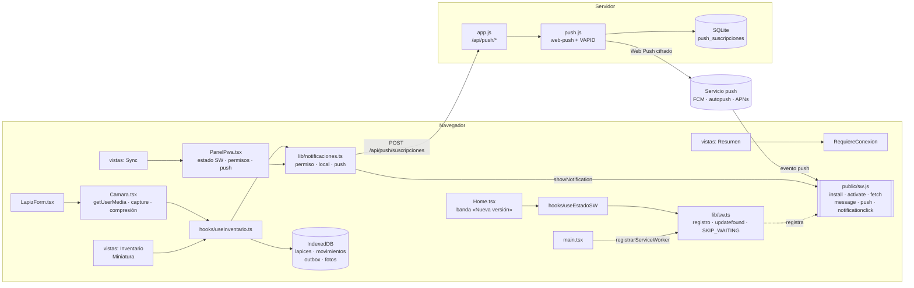

# LapiStock — Service Worker, notificaciones y cámara

**Proyecto:** PWA de inventario de lápices (continuación del [documento técnico](DOCUMENTO-TECNICO.md)).
**Fecha:** 24/10/2026

Esta entrega agrega a LapiStock el ciclo de vida completo del Service Worker (con aviso de
actualización), notificaciones locales y push reales, y acceso a la **cámara** del dispositivo.

---

## Punto 1. Planeación

### 1.1 Funciones con y sin conectividad

| Función | Sin conexión | Por qué |
|---|---|---|
| Abrir la app (splash, home, navegación) | ✅ Funciona | App shell precacheado por el Service Worker |
| Consultar inventario, buscar, filtrar, KPIs locales | ✅ Funciona | Copia local en IndexedDB |
| Alta / edición / baja de lápices | ✅ Funciona | Se guarda en local y entra a la cola `outbox` |
| Entradas y salidas de stock | ✅ Funciona | Validación local + cola; el servidor revalida al sincronizar |
| **Tomar foto con la cámara** | ✅ Funciona | La cámara es local; la foto se guarda en IndexedDB |
| **Notificación local de bajo stock** | ✅ Funciona | La genera la app, no el servidor |
| Bitácora, tema, preferencias | ✅ Funciona | localStorage |
| Sincronizar la cola con el servidor | ❌ Requiere conexión | Se pospone y se reintenta sola al reconectar |
| Resumen calculado por el servidor (SQL) | ⚠ Requiere conexión | Offline muestra la última copia guardada y un aviso |
| Activar notificaciones **push** / enviar push de prueba | ❌ Requiere conexión | Hay que registrar la suscripción en el servidor y en el servicio push del navegador |
| Recibir push del servidor | ❌ Requiere conexión | El mensaje viaja por el servicio push (FCM, autopush, APNs) |
| Buscar versión nueva del Service Worker | ❌ Requiere conexión | `reg.update()` descarga `sw.js` |

Cuando una función necesita red, la interfaz lo dice con un aviso amarillo «📡 …» (componente
`RequiereConexion`) y deshabilita el botón correspondiente.

### 1.2 Característica del dispositivo: cámara

Se eligió la **cámara** (captura de imagen) porque encaja con el inventario: fotografiar el lápiz
o su empaque ayuda a reconocer el producto en la bodega. Se usa `MediaDevices.getUserMedia` con
la cámara trasera (`facingMode: environment`) y, como respaldo, `<input type="file" capture>`
(cámara/galería del sistema) para navegadores sin la API o con el permiso bloqueado.

- Antes de pedir el permiso se muestra una explicación: para qué se usa y que la foto **no sale del
  dispositivo**.
- La foto se redimensiona (lado máximo 800 px) y se comprime a JPEG 0,8 (≈ 6–60 KB) antes de
  guardarla en IndexedDB (store `fotos`, versión 2 de la BD).
- Se muestra como miniatura en las tarjetas del inventario y en el formulario de edición.

### 1.3 Notificaciones: tipo y cuándo se muestran

| Notificación | Tipo | Cuándo | Etiqueta (`tag`) |
|---|---|---|---|
| «Notificaciones activadas» | Local | Al conceder el permiso (confirmación) | `prueba` |
| «Bajo stock» | Local | Tras registrar una **salida** que deja el stock ≤ mínimo, **también sin conexión** | `bajo-stock-<id>` |
| «Cambios sincronizados» | Local | Cuando se envía la cola acumulada offline (al reconectar, al abrir o por el reintento automático); no tras cada cambio en línea | `sync` |
| «Bajo stock» (push) | **Push del servidor** | Cuando el servidor recibe una salida nueva que deja un lápiz en bajo stock; llega a **todos** los dispositivos suscritos aunque la app esté cerrada | `bajo-stock-<id>` |
| «Notificación push de prueba» | Push del servidor | Botón «Enviar push de prueba» | `prueba` |

La notificación local y la push de bajo stock comparten etiqueta: si un dispositivo recibe las dos,
el navegador reemplaza una por la otra en lugar de mostrar un duplicado. Al tocar una notificación se
abre (o enfoca) la app directamente en la pestaña indicada (`/?vista=inventario` o `/?vista=sync`).

El permiso **solo se pide al pulsar un botón** («Activar notificaciones» en la pestaña Sync), nunca al
abrir la app: los navegadores bloquean o penalizan las peticiones automáticas.

### 1.4 Esquema de componentes

Archivos nuevos: `front/src/lib/sw.ts`, `front/src/lib/notificaciones.ts`,
`front/src/hooks/useEstadoSW.ts`, `front/src/components/Camara.tsx`,
`front/src/components/PanelPwa.tsx`, `api/src/push.js`.
Modificados: `public/sw.js`, `main.tsx`, `Home.tsx`, `vistas.tsx`, `LapizForm.tsx`,
`useInventario.ts`, `idb.ts`, `api.ts`, `types.ts`, `App.css`, `api/src/app.js`, `api/src/server.js`.

---

## Punto 2. Programación

### 2.1 Service Worker: registro, instalación, activación y actualización

**Registro** — `front/src/lib/sw.ts` (`registrarServiceWorker()` se llama desde `main.tsx`). Solo
en el build de producción, para no romper la recarga en caliente de Vite. Expone el estado
(`registrando`, `activo`, `actualizacion`, `error`, `desactivado`, `no-soportado`) a React con
`useSyncExternalStore` (`hooks/useEstadoSW.ts`); se ve en Sync → «App y notificaciones».

**Ciclo de vida** — `front/public/sw.js`:

| Evento | Qué hace |
|---|---|
| `install` | Abre `lapistock-app-<versión>` y precachea el app shell + todos los archivos del build (lista inyectada por el plugin `precache-sw`). **Ya no llama a `skipWaiting()` por su cuenta.** |
| `activate` | Borra las cachés `lapistock-app-*` de versiones anteriores y hace `clients.claim()`. |
| `message` `SKIP_WAITING` | Activa la versión en espera cuando el usuario lo pide. |
| `fetch` | Navegación: red primero → `index.html` cacheado. Estáticos: caché primero. `GET /api/*`: red primero con copia en `lapistock-api`. |
| `push` | Muestra la notificación con el título/cuerpo/etiqueta/URL que manda el servidor. |
| `notificationclick` | Cierra la notificación y enfoca una ventana abierta de la app (navegándola a la URL) o abre una nueva. |

**Actualización:**
1. Cada build produce un `sw.js` con otra versión (hash SHA-256 del contenido del build).
2. El navegador lo compara al navegar; la app además llama a `reg.update()` al volver a la pestaña
   (`visibilitychange`) y cada hora.
3. El SW nuevo se instala y queda **en espera** (`waiting`). `sw.ts` lo detecta con
   `updatefound` → `statechange: installed` y, si ya había un controlador, cambia el estado a
   `actualizacion`.
4. Home muestra la banda **«Hay una nueva versión de LapiStock — Actualizar»**
   ([captura 15](capturas/15-actualizacion.png)).
5. Al pulsar *Actualizar* se envía `SKIP_WAITING`; el SW nuevo se activa, borra las cachés viejas y
   dispara `controllerchange`, y la página se recarga una sola vez.

Esperar la confirmación evita cambiar el código de la app en mitad de un registro. En la primera
visita no hay nada que reemplazar y el SW se activa directamente.

### 2.2 Funcionamiento offline

Se mantiene la estrategia de la entrega anterior (ver [documento técnico §2.3](DOCUMENTO-TECNICO.md#23-apis-utilizadas)):
el app shell (HTML, JS y CSS con hash, manifest, logo, íconos) se precachea en `install`, así la
interfaz principal abre sin conexión. Las fotos viven en IndexedDB, así que también se ven offline.

IndexedDB pasó a **versión 2** para agregar el store `fotos`. `onupgradeneeded` ahora migra por
pasos (`if (oldVersion < 1)…`, `if (oldVersion < 2)…`): quien ya tenía la app conserva su inventario
y su cola pendiente.

### 2.3 Notificaciones

**Locales** — `front/src/lib/notificaciones.ts`:
- `pedirPermiso()` llama a `Notification.requestPermission()` solo desde el clic del botón.
- `notificarLocal()` usa `registration.showNotification()` (obligatorio en Android, donde
  `new Notification()` lanza error) y cae al constructor si no hay SW. No hace nada si el permiso no
  está concedido.
- Disparadores en `useInventario.ts`: salida que deja bajo stock y vaciado de la cola offline.

**Push reales (ampliación)** — Web Push con claves VAPID y la librería `web-push` en el servidor:

| Pieza | Detalle |
|---|---|
| Claves VAPID | `api/src/push.js` las toma de `VAPID_PUBLIC_KEY`/`VAPID_PRIVATE_KEY` o las genera una vez y las guarda en `api/data/vapid.json` (en `.gitignore`; ruta configurable con `VAPID_FILE`) |
| `GET /api/push/clave-publica` | Clave pública que el navegador necesita para suscribirse |
| `POST /api/push/suscripciones` | Guarda `{ endpoint, keys: { p256dh, auth } }` en la tabla `push_suscripciones` (valida que el endpoint sea `https://`; reenviar la misma no duplica) |
| `DELETE /api/push/suscripciones` | Borra la suscripción (`{ endpoint }`) |
| `POST /api/push/prueba` | Envía una push a todos los suscritos; responde `{ enviadas, fallidas }` |
| Aviso automático | `POST /api/movimientos`: si una salida **nueva** (no un reintento duplicado) deja el lápiz en bajo stock, el servidor envía la push sin bloquear la respuesta |
| Limpieza | Si el servicio push responde 404/410 (suscripción caducada) se borra de la BD |

En el cliente, `suscribirPush()` pide el permiso, obtiene la clave, se suscribe con
`pushManager.subscribe({ userVisibleOnly: true, applicationServerKey })` y envía la suscripción al
servidor. Si el servidor cambió de claves VAPID, la suscripción vieja se descarta y se crea otra. Si el
servicio push del navegador no responde en 15 s se muestra un error en lugar de dejar el botón
esperando.

### 2.4 Cámara

`front/src/components/Camara.tsx`:

1. **Aviso previo** del permiso, con el estado leído de `navigator.permissions.query({ name: 'camera' })`
   cuando el navegador lo expone; si está bloqueado se indica cómo desbloquearlo.
2. **«Permitir y abrir cámara»** → `getUserMedia({ video: { facingMode: { ideal: 'environment' } } })`
   (solo en contexto seguro). Vista previa en `<video playsInline muted>` (necesario en iOS).
3. **«Capturar»** dibuja el fotograma en un `<canvas>`, lo reduce y lo exporta a JPEG; luego detiene
   las pistas de la cámara (se apaga el indicador). También se detienen al cancelar o cerrar.
4. **«Elegir archivo»** (`<input type="file" accept="image/*" capture="environment">`) como respaldo;
   pasa por la misma compresión (`createImageBitmap`).
5. Errores traducidos a mensajes útiles: `NotAllowedError` (permiso denegado), `NotFoundError`
   (sin cámara), `NotReadableError` (cámara ocupada por otra app), contexto no seguro.

El modal se pinta con un **portal** en `<body>` (el modal del formulario lo recortaba), pero sigue
dentro del árbol de React del `<form>` para que sus clics no cierren el formulario.

### 2.5 Integración en las pantallas existentes

| Pantalla | Qué se agregó |
|---|---|
| **Home** (todas las vistas) | Banda «Hay una nueva versión… Actualizar»; abrir `/?vista=…` desde una notificación lleva a esa pestaña |
| **Formulario de lápiz** | Bloque «Foto (opcional) · requiere permiso de cámara»: Tomar/Cambiar foto, Quitar, miniatura |
| **Inventario** | Miniatura de la foto en cada tarjeta |
| **Movimientos** | Una salida que deja bajo stock genera la notificación local |
| **Resumen** | Aviso «necesita conexión» y botón *Actualizar* deshabilitado offline |
| **Sync** | Aviso «requiere conexión» en la cola; panel **«App y notificaciones»**: estado del SW, permiso, push, botones *Activar notificaciones*, *Probar notificación local*, *Activar/Desactivar push*, *Enviar push de prueba* |

### 2.6 Configuración realizada

| Qué | Dónde | Valor |
|---|---|---|
| Dependencia nueva | `api/package.json` | `web-push` ^3.6 |
| Variables de entorno (opcionales) | servidor | `VAPID_PUBLIC_KEY`, `VAPID_PRIVATE_KEY`, `VAPID_FILE` (por defecto `api/data/vapid.json`) |
| Tabla nueva | SQLite | `push_suscripciones (endpoint PK, p256dh, auth, creado_en)` |
| Store nuevo | IndexedDB `lapistock` v2 | `fotos` (`keyPath: lapiz_id`) |
| Ignorados en git | `.gitignore`, `api/.gitignore` | `api/data/vapid.json` (clave privada) |
| Requisito | despliegue | **HTTPS** (o `localhost`) para Service Worker, cámara y push |
| Chrome de prueba | `pruebas/e2e-offline.mjs` | `--use-fake-device-for-media-stream` (cámara simulada) y `Browser.grantPermissions` |

Para probar a mano: `npm run build && npm start`, abrir http://localhost:3000 en Chrome, pestaña
**Sync** → *Activar notificaciones* → *Activar push* → *Enviar push de prueba*. Después, en
**Inicio → Registrar nuevo lápiz → Tomar foto**.

---

## Punto 3. Pruebas y documentación

### 3.1 Resultados — `npm run build && npm run test:e2e`

Chrome headless real, perfil limpio, viewport móvil 412×860. **16/16 pruebas OK** (dos ejecuciones
seguidas). Resultado completo en [`pruebas/resultados-e2e.json`](../pruebas/resultados-e2e.json).

| # | Prueba solicitada | Resultado | Evidencia |
|---|---|---|---|
| 1 | La aplicación registra correctamente el Service Worker | ✅ OK — controla la página; cachés `lapistock-app-<hash>`, `lapistock-api`; el panel dice «Activo y controlando la app» | [11](capturas/11-notificaciones.png) |
| 1b | El Service Worker se actualiza (instalación → espera → aviso → activación) | ✅ OK — se publica un `sw.js` distinto, aparece la banda, *Actualizar* deja la versión nueva activa sin `waiting` | [15](capturas/15-actualizacion.png) |
| 2 | Los recursos esenciales se cargan con el modo sin conexión activo | ✅ OK — servidor apagado + red emulada offline: la app recarga y abre | [04](capturas/04-offline-home.png) |
| 3 | La app informa cuando una función necesita conexión | ✅ OK — Resumen: «El resumen lo calcula el servidor: necesita conexión…», botón deshabilitado; 2 avisos en Sync | [14](capturas/14-offline-requiere-conexion.png) |
| 4 | La notificación se muestra después de conceder el permiso | ✅ OK — permiso inicial `default` → concedido → la notificación aparece en `registration.getNotifications()` | [11](capturas/11-notificaciones.png) |
| 4b | Notificación local de bajo stock tras una salida | ✅ OK — salida de 2 deja 2 ≤ mín. 3 → notificación «Bajo stock» | — |
| 4c | Push real: suscripción + envío desde el servidor | ✅ OK — suscripción con VAPID; `POST /api/push/prueba` → «El servidor envió 1 notificación(es) push» y el SW la muestra | — |
| 5 | La cámara funciona en un navegador compatible con el permiso autorizado | ✅ OK — vídeo activo, foto capturada y guardada como `image/jpeg` (~6–8 KB) en IndexedDB; miniatura en el inventario | [12](capturas/12-camara.png), [13](capturas/13-foto-inventario.png) |
| — | Pruebas previas (splash, home, cola offline, persistencia, sincronización, sin duplicados) | ✅ OK — siguen pasando | [01–10](capturas/) |

`npm test` (API): **9/9 OK** — se agregó *push: clave pública VAPID y alta/baja de suscripciones*
(valida que se rechacen endpoints `http://` y suscripciones sin claves, y que reenviar no duplique).

Si el entorno no puede alcanzar el servicio push (red bloqueada), la prueba de push se registra como
**LIMITACIÓN** en lugar de FALLA, con el motivo.

### 3.2 Errores encontrados y corregidos

| # | Error | Causa | Corrección |
|---|---|---|---|
| 1 | El modal de la cámara salía recortado dentro del formulario | El modal del formulario crea su propio contexto de apilamiento | Portal a `<body>` (`createPortal`) |
| 2 | Riesgo: un clic en el fondo del modal de cámara cerraba también el formulario | El evento burbujea por el árbol de React hasta el fondo del formulario | El portal se monta dentro del `<form>` (que detiene la propagación) |
| 3 | *Activar push* se quedaba en «ocupado» para siempre en Chrome headless | `pushManager.subscribe()` no responde si el servicio push (FCM) es inalcanzable | Tiempo límite de 15 s con mensaje de error |
| 4 | La prueba de notificación fallaba de forma intermitente | Chrome headless descarta a veces la **primera** notificación de un perfil nuevo (`showNotification` resuelve pero no aparece en `getNotifications`); comprobado con notificaciones directas que sí aparecen | La prueba también pulsa *Probar notificación local* y reporta cuáles se mostraron |
| 5 | La captura 11 salía con el splash encima | La prueba no esperaba a que terminara el splash tras recargar | `esperarHome()` antes del paso |
| 6 | Riesgo al subir IndexedDB a v2: volver a crear stores existentes aborta la apertura | El `onupgradeneeded` original creaba todo sin mirar la versión | Migración por pasos con `oldVersion` |
| 7 | Una versión nueva del SW se activaba sola en mitad de un registro | `install` llamaba a `skipWaiting()` | Espera a la confirmación del usuario (`SKIP_WAITING`) |
| 8 | Avisos de oxlint (`set-state-in-effect`, `only-export-components`) | `setState` dentro de un efecto en `Miniatura`; un hook exportado junto a componentes | `useMemo` para la URL del Blob; hook movido a `hooks/useEstadoSW.ts` |

### 3.3 Compatibilidad y limitaciones

| Función | Chrome / Edge (escritorio y Android) | Firefox | Safari macOS | Safari iOS / iPadOS |
|---|---|---|---|---|
| Service Worker + caché offline | ✅ | ✅ | ✅ | ✅ |
| Aviso de actualización del SW | ✅ | ✅ | ✅ | ✅ |
| Notificaciones locales | ✅ | ✅ | ✅ 16+ | ⚠ Solo 16.4+ y con la app **instalada** en la pantalla de inicio |
| Push del servidor | ✅ (FCM / WNS) | ✅ (autopush) | ✅ 16+ (APNs) | ⚠ Solo 16.4+ e instalada |
| Cámara `getUserMedia` | ✅ | ✅ | ✅ | ✅ (requiere `playsinline`, ya incluido) |
| Estado previo del permiso de cámara (`permissions.query`) | ✅ | ❌ (se omite el aviso de estado; el resto funciona) | ✅ 16+ | ✅ 16+ |
| `<input capture>` (respaldo) | ✅ Android abre la cámara; escritorio abre el selector de archivos | igual | selector de archivos | ✅ abre la cámara |

- **HTTPS obligatorio:** Service Worker, cámara y push solo funcionan en HTTPS o `localhost`. Abrir la
  app desde el móvil por `http://192.168.x.x` no registra el SW, no abre la cámara en vivo (queda el
  respaldo «Elegir archivo») y no permite push.
- **Push depende de un servicio externo** del fabricante del navegador (FCM, autopush, APNs). En redes
  que lo bloquean, o en navegadores sin esos servicios (algunos Chromium sin Google), la suscripción
  falla tras 15 s con un mensaje. Las notificaciones **locales** no dependen de él.
- **Permisos denegados:** si el usuario bloquea notificaciones o cámara, la app no puede volver a
  preguntar; muestra cómo desbloquearlo desde la configuración del sitio.
- **Fotos solo locales:** no se sincronizan con el servidor ni se ven en otros dispositivos; se borran
  si el navegador limpia los datos del sitio. Subirlas implicaría un endpoint de archivos y
  almacenamiento en el servidor.
- **Push sin usuarios:** todas las suscripciones reciben todos los avisos (no hay cuentas).
- **Claves VAPID:** si se borra `api/data/vapid.json` (o se cambian las variables), las suscripciones
  existentes dejan de funcionar; la app se vuelve a suscribir al pulsar *Activar push*.
- **Comprobación de versión del SW:** necesita conexión; offline se sigue usando la versión instalada.
- **Notificación de bajo stock offline:** se muestra con el stock local; si al sincronizar el servidor
  rechaza la salida (409), el aviso ya se mostró.
- **Chrome headless (pruebas):** la cámara se simula con `--use-fake-device-for-media-stream` (patrón
  verde de prueba) y los permisos se conceden con `Browser.grantPermissions`; la primera notificación
  de un perfil nuevo puede no listarse (ver error 4).
